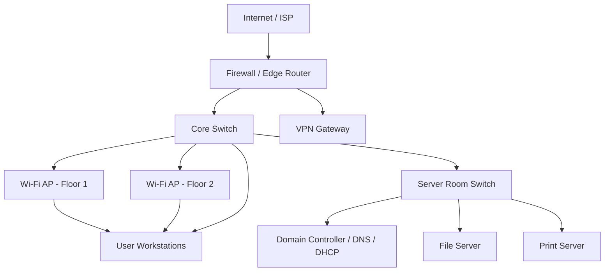

# Network Topology Overview

Reference topology for a small/medium office network — the environment the runbooks in this repo assume.

## Key components

| Component | Role | Common failure points |
|---|---|---|
| Firewall / Edge Router | Internet gateway, NAT, VPN termination | WAN link down, cert expiry on VPN, misconfigured ACLs |
| Core Switch | Backbone connectivity between floors and server room | Port failure, VLAN misconfiguration, spanning-tree loops |
| Domain Controller (DNS/DHCP) | Name resolution, IP address leasing, authentication | DHCP scope exhaustion, DNS record staleness, service crash |
| File / Print Server | Shared resources | Disk I/O bottlenecks, permission/ACL issues, driver conflicts |
| Wi-Fi APs | Wireless access per floor | Channel congestion, weak signal, firmware bugs |

This diagram is intentionally simplified — it documents the layer at which most day-to-day help-desk tickets originate (edge, DNS/DHCP, and access layer) rather than a full physical topology.
